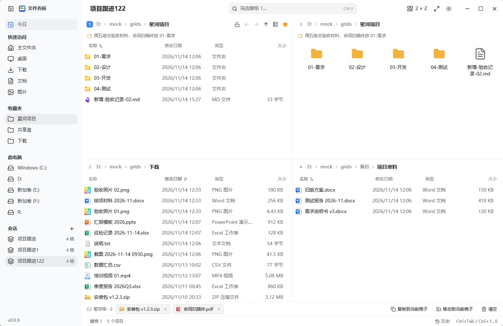
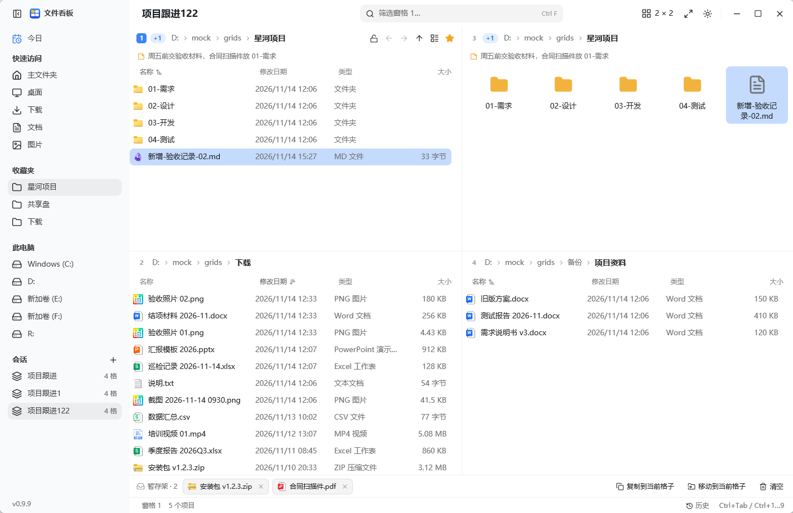
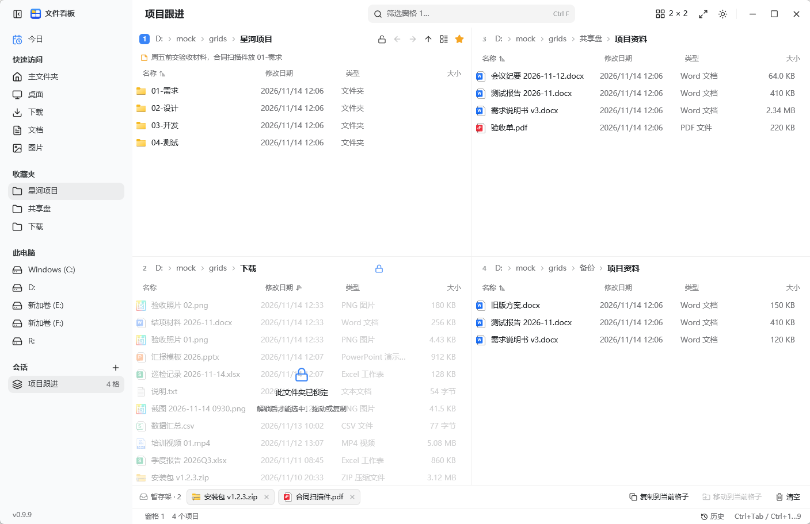
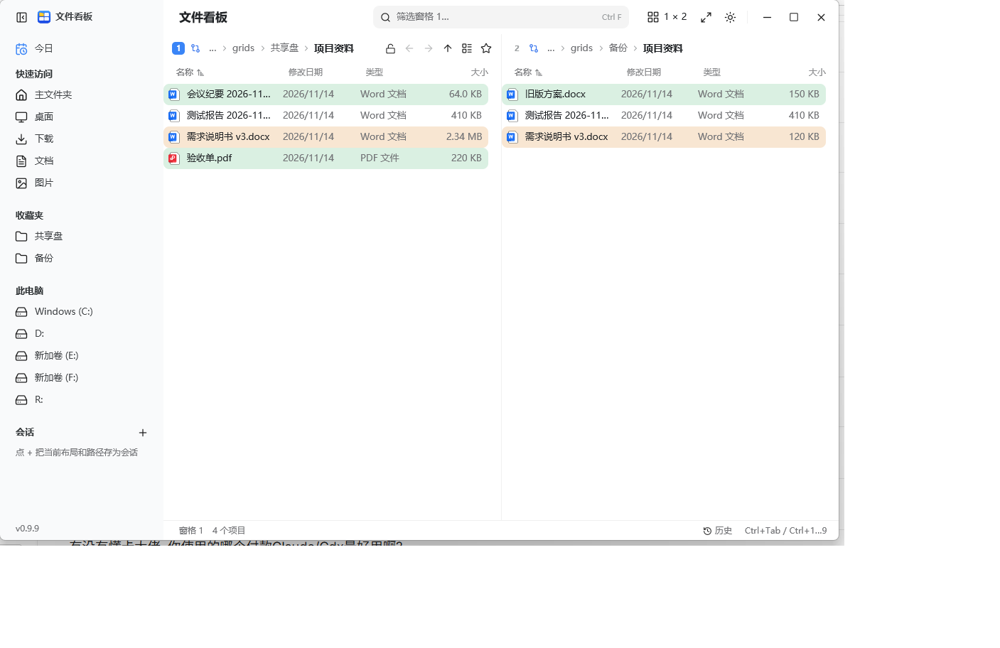
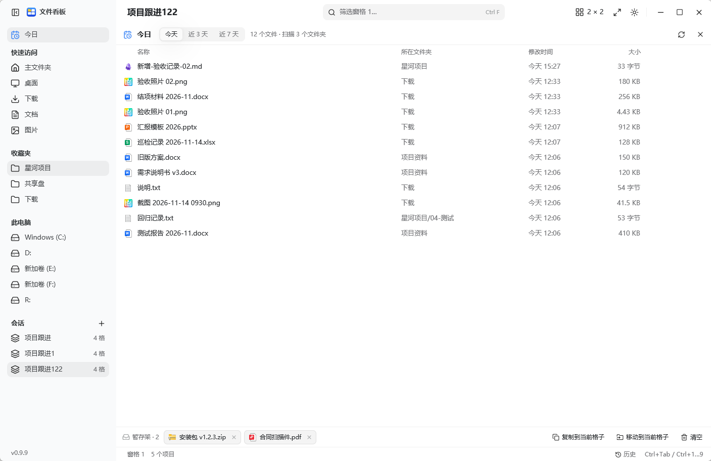
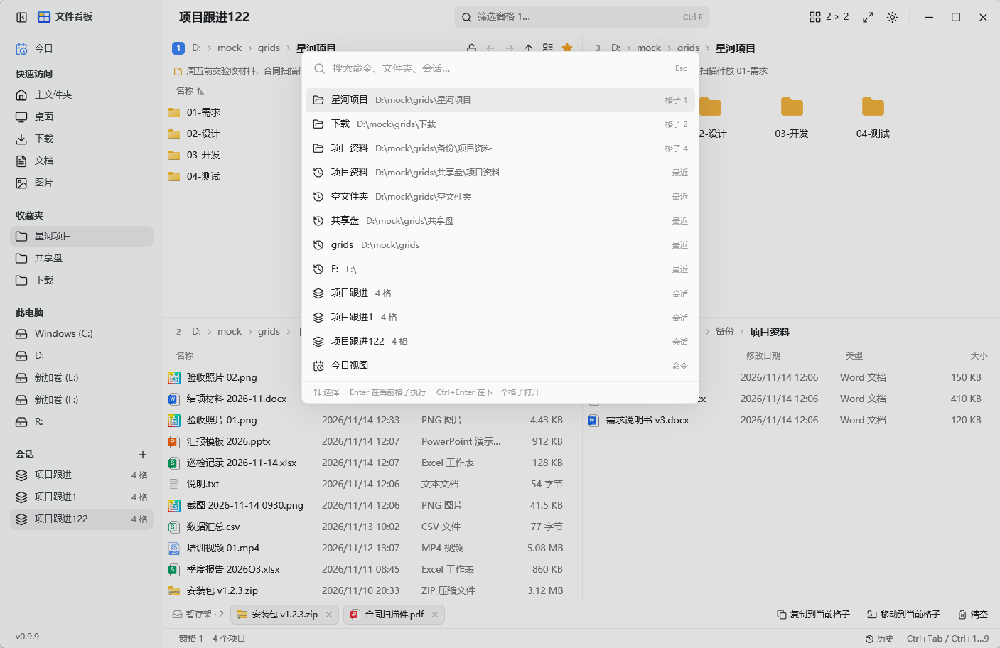
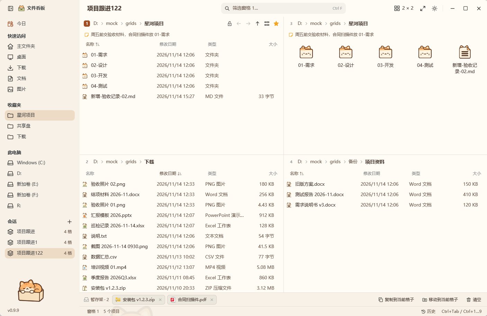
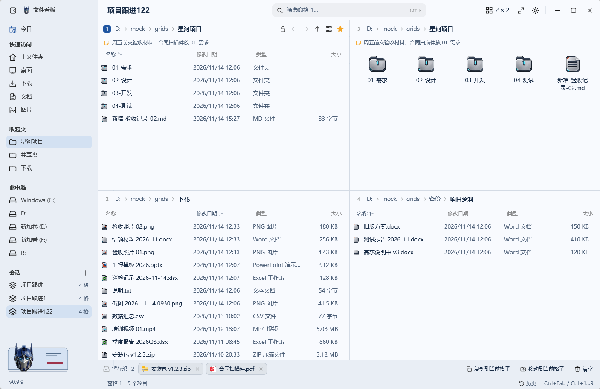

# PaneBoard

**English** | [简体中文](README.md)

A multi-pane file manager for Windows. One window holds up to sixteen panes; changes highlight as they happen, a folder can be locked read-only, two folders can be compared side by side, and files can be collected on a shelf before they are moved.

The whole interface is drawn by the program itself (a Rust UI framework, GPUI); no Explorer view is embedded. The app is a single exe with the themes compiled in, written out on first run.



Screenshots use a mock folder tree, not a real desktop.

## Why this exists

Moving files around on Windows usually means:

- Explorer shows one folder at a time, so copying means switching windows until you lose track.
- "What changed recently?" means sorting by date and visiting each folder by hand.
- Showing an archive to someone is risky: one slip renames, deletes or drags something away.
- Checking a backup against the original is a line-by-line stare.
- Collecting files from several folders means copying and pasting one at a time.

PaneBoard puts those actions in one window: several panes at once, live change counts, a read-only lock, linked comparison, a shelf, plus a command palette and undo.

## What you get

- Fewer windows: four panes side by side, source on the left, target on the right, drag once.
- Nothing missed: a pane that changed shows `+1`, `+2` beside its title until you touch it.
- No accidents: lock a pane and the mouse and keyboard cannot select, open, drag, rename or delete.
- Faster checks: link two panes and compare; green marks names on one side only, amber marks same name with a different size or date.
- A way back to recent work: the Today view gathers today, three days and seven days across every pane folder.

## Features

### Panes and layout

- 1 to 16 panes: up to four columns, one to four rows each. Thirteen presets, plus a custom column picker whose bars can be dragged.
- Drag the dividers to resize; double-click a divider to split a column evenly.
- Every pane keeps its folder, history, sort, column widths and view; swapping two panes moves all of it.
- The sidebar holds Today, quick access, favourites, drives and saved sessions.

### Files

- Breadcrumb path: click a folder to enter, click `›` for its subfolders.
- Name filter (Ctrl+F), five views (Ctrl+Shift+1 to 5), sortable and resizable columns.
- Hidden files (Ctrl+H), a star for favourites, and one line of notes under the title.
- Selection works like Explorer: click, Ctrl+click, Shift+click, Ctrl+A, and a rubber band on empty space.
- Right-click menu: open, open in the next pane, cut, copy, paste into folder, rename, delete, compress to ZIP, note, favourite, add to shelf, show in Explorer, size on disk, properties.

### Watching and change highlights



- New or changed files highlight for four seconds: full strength, then a fade.
- The counter beside the title (`+1`, `+2`…) keeps adding up until you touch that pane.
- Changes that happened while you were elsewhere still count, so sixteen panes still tell you where to look.

### Read-only lock

The padlock in a pane's header locks its folder. The pane is then veiled: no selecting, opening, dragging, renaming or deleting, and only that pane's padlock can lift it.



The lock lives inside PaneBoard; it is not an NTFS permission.

### Linking and comparing

Link two panes and one follows the other into the same relative subfolder, up to four pairs. With exactly two linked panes, compare marks the differences.



### Today

Today, three days or seven days of changes across every pane folder, newest first, each labelled with the folder it came from.



Enter opens, Ctrl+Enter reveals it in its pane, Ctrl+C copies, Ctrl+Shift+A shelves it, Delete sends it to the recycle bin.

### Shelf

Drag files onto the shelf at the bottom, or press Ctrl+Shift+A, then copy or move them into the current pane. Collecting across folders and panes is the point.

### Sessions

Everything saves as you go. Name the current layout in the sidebar and it comes back with every pane's folder.

### Command palette and the less obvious parts

Ctrl+K opens the palette over commands, open folders and saved sessions.



Enter runs a command or opens a folder, Ctrl+Enter opens it in the next pane.

| Feature | How |
| --- | --- |
| Address bar | Ctrl+L or Alt+D: a path, `..`, a subfolder name, or a command such as `cmd` |
| Collect | Ctrl+Shift+A puts the selection on the shelf |
| Undo | Ctrl+Z; the history panel lists the last 500 operations |
| Maximise a pane | Ctrl+Shift+M, or double-click its title bar |
| Move the cursor only | Ctrl+↑ / Ctrl+↓, leaving the selection alone |
| Copy the full path | Ctrl+Shift+C |
| Swap panes | Ctrl+Alt+Shift+arrow |
| Hide the sidebar | Ctrl+B |
| Explorer's own menu | Shift+F10 or the menu key |

### Themes

Two themes ship inside the exe and expand into `themes\` on first run:

- **奶油猫咪 (Cream Cat)**: warm cream palette, cat illustrations and icons.
- **变形金刚 (Transformers)**: steel blue palette, metal illustrations and icons.





A theme is not a palette swap: colours, all 89 toolbar icons, file-type icons, empty-folder and no-results illustrations, the missing-folder illustration, the popover banner, the sidebar illustration and the window backdrop all change.

Light, dark and follow-system stay independent of the theme; every pack carries both palettes. Pick one under the version label at the bottom left and the app restarts into it.

Themes are open: a folder with `theme.json`, `icons/`, `types/` and a few illustrations, dropped into `themes\`. The format is in [docs/theme-assets.md](docs/theme-assets.md).

## Keyboard

| Key | Action |
| --- | --- |
| Ctrl+Tab / Ctrl+Shift+Tab | Next / previous pane |
| Ctrl+1 … Ctrl+9 | Jump to pane N |
| Ctrl+Alt+Shift+arrows | Swap with the neighbouring pane |
| Ctrl+Shift+M | Maximise / restore the pane |
| Ctrl+Shift+G | Layout picker |
| Ctrl+B | Show / hide the sidebar |
| Alt+← / Alt+→ / Alt+↑ | Back / forward / up |
| Ctrl+L, Alt+D | Address bar |
| Ctrl+F | Name filter |
| Ctrl+H | Hidden files |
| Ctrl+A | Select all |
| Ctrl+C / Ctrl+X / Ctrl+V | Copy / cut / paste |
| Ctrl+Shift+C | Copy the full path |
| Ctrl+Shift+A | Shelf the selection |
| F2 / Delete / Shift+Delete | Rename / recycle / delete for good |
| F5 | Reload |
| F7, Ctrl+Shift+N | New folder |
| Alt+Enter | Properties |
| Shift+F10, menu key | Context menu |
| Ctrl+Shift+1 … 5 | Views: extra large, large, medium, list, details |
| Ctrl+K | Command palette |
| Ctrl+Z | Undo the last operation |
| Ctrl+↑ / Ctrl+↓ | Move the cursor without changing the selection |

## Download

Grab `grids-<version>.exe` from [Releases](https://github.com/Joyi-code/grids/releases/latest) and run it from any folder: one file. Both themes are inside; the first run writes `themes\` beside it.

Nothing to install, the C runtime is linked statically. The exe is not code-signed, so SmartScreen may warn once: More info, Run anyway. Windows 10 (1903+) or Windows 11, x64.

## Updates

One check at startup; when a newer release exists the bottom left shows "更新到 x.y.z". One click downloads it, checks the SHA-256, swaps the exe and restarts, with a percentage while it downloads.

Only the exe is replaced: `grids-gpui.json`, `grids-journal.jsonl` and `themes\` are never deleted or rewritten, and a failed check leaves everything untouched.

## Privacy

The only network request is the version check: one GET to `api.github.com/repos/Joyi-code/grids/releases/latest`, no parameters, no identifiers, sent by the system `curl.exe`; the app links no network library. The switch in the version popover turns it off, and then nothing leaves the machine. No telemetry, no file names or folder contents.

## Limits

- The read-only lock only applies inside PaneBoard.
- Compare looks at names, sizes and dates; folders are compared by existence, not recursively.
- The Today view scans three levels in each pane folder, at most 20,000 files.
- Undo covers operations PaneBoard recorded; changes made elsewhere are not tracked.
- Folder icons come from the theme; without a `types\` folder they fall back to the system icons.

## Contributing

- Ideas, new themes, bug reports: open an [Issue](https://github.com/Joyi-code/grids/issues).
- Code or theme pull requests are welcome; run `cargo test --release --locked --workspace` first.
- Next up: more themes (craft, pixel, minimal), better drag and drop, batch rename, more file operations. Tell me what you want first.

## Building from source

Rust from [rustup](https://rustup.rs) (pinned in `rust-toolchain.toml`) and the Windows SDK; GPUI compiles its shaders with the SDK's `fxc.exe`.

```
build.cmd
```

or `cargo build --release --locked`. The result is one `grids.exe`; `grids-gpui.json` and `grids-journal.jsonl` are written next to it, so that folder must be writable. `GRIDS_CONFIG=<path>` moves the config, `GRIDS_LANG=en` starts in English, `GRIDS_LOG=info` logs to stderr.

## Contact

WeChat: `pixel-cafetime`


Say what you are writing about before adding the contact.

## Credits

PaneBoard is a fork of [efww/grids](https://github.com/efww/grids) (MIT). The rewrite is built on [GPUI](https://www.gpui.rs). Third-party notices are in [THIRD_PARTY.md](THIRD_PARTY.md).

## Licence

[MIT](LICENSE)

