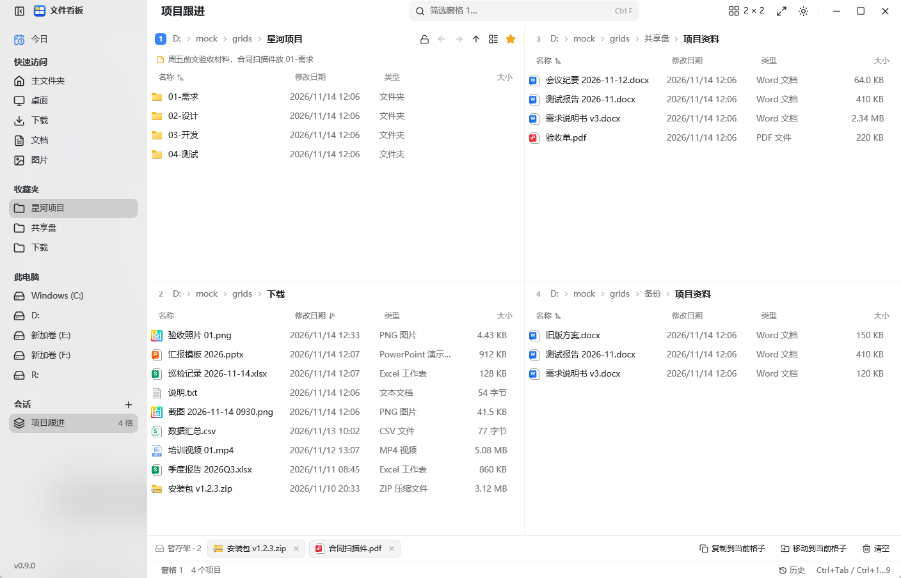
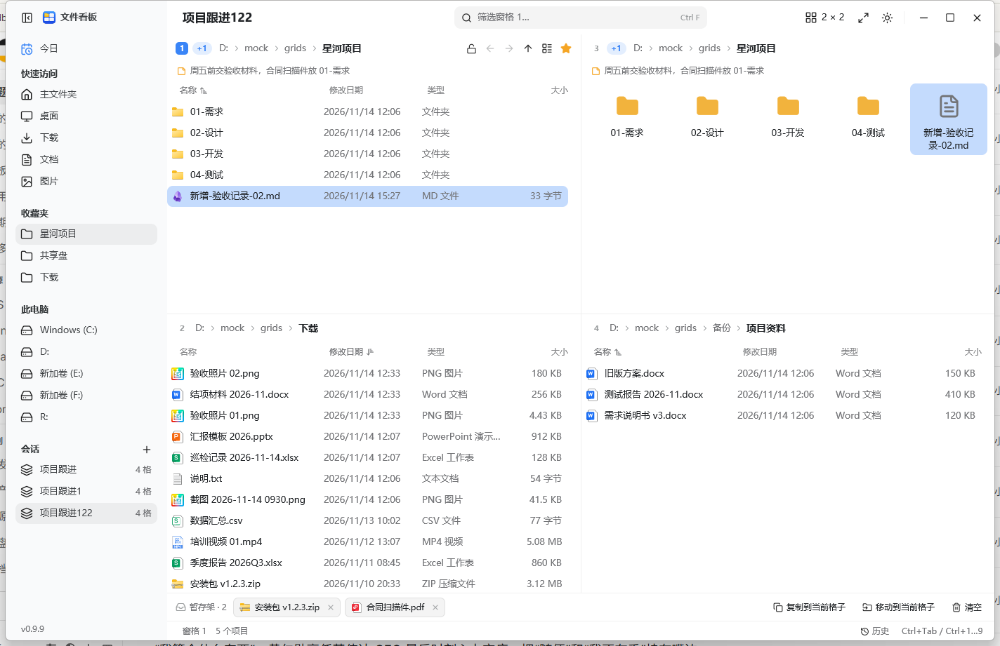
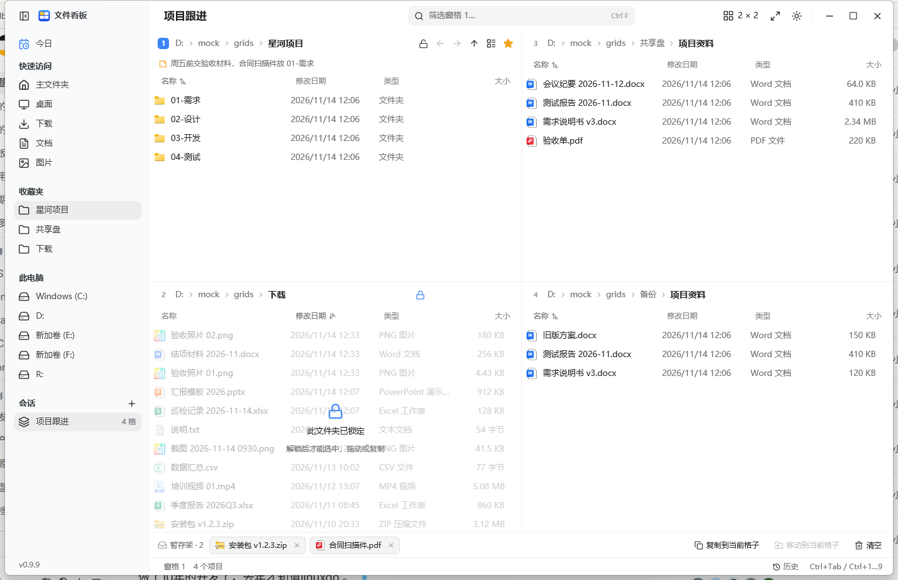
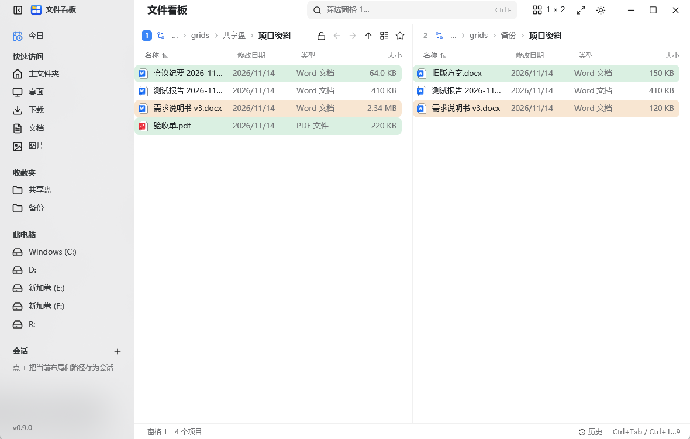
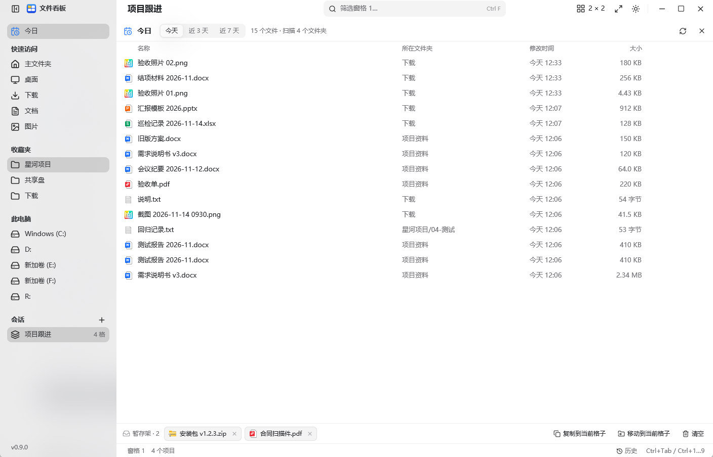
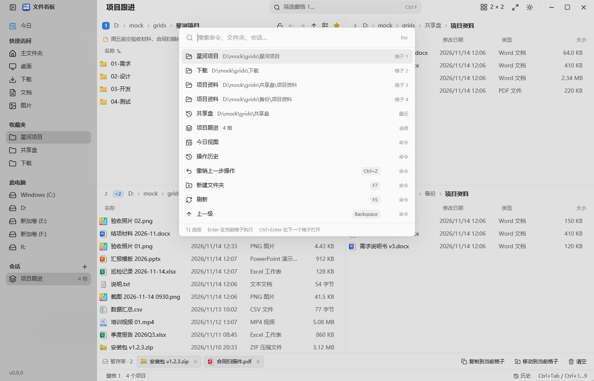
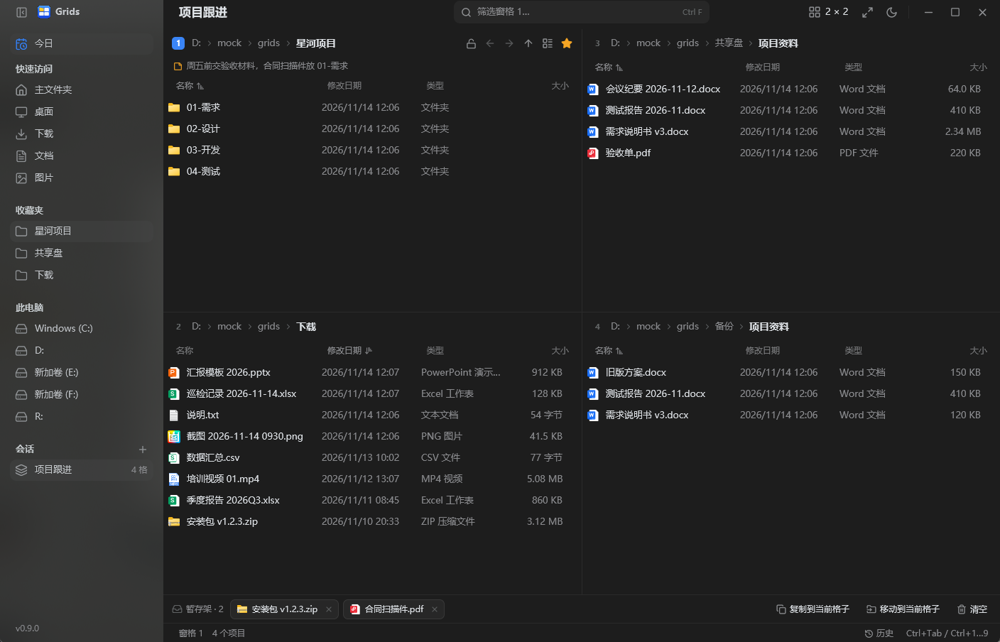

# Grids

[English](README.md) | [简体中文](README.zh.md) | **한국어**

Windows용 다중 패널 파일 관리자입니다. 창 하나에 최대 16개의 패널을 두고, 끌어서 배치를 바꿉니다. 탐색기에 없는 기능도 있습니다. 오늘 보기, 바뀐 파일 강조, 끌어낼 수 없는 읽기 전용 폴더, 두 폴더를 비교하는 연동 패널, 패널 사이로 파일을 옮기는 보관함입니다.

이 저장소는 포크이자 다시 만든 것입니다. Grids는 [efww/grids](https://github.com/efww/grids)에서 시작했고, 그 프로그램은 탐색기 뷰를 패널에 넣은 Q-Dir 스타일 관리자였습니다. 여기에서는 창과 파일 목록, 모든 메뉴와 대화상자를 [GPUI](https://www.gpui.rs)(Zed의 Rust UI 프레임워크)로 직접 그립니다. 탐색기 뷰를 넣지 않으며, 프로그램은 약 5.5MB의 exe 하나이고 네트워크를 쓰지 않습니다.



이 문서의 스크린샷은 실제 컴퓨터가 아니라 시연용 가상 폴더입니다.

## 패널과 배치

- 패널 1~16개: 열 4개까지, 열마다 패널 1~4개. 배치 버튼에 13가지 프리셋이 있고, **열 기준** 막대를 눌러 열마다 개수를 정하며, 끌어서 여러 열을 한 번에 바꿀 수 있습니다.
- 경계를 끌어 크기를 바꾸고, 두 번 눌러 같은 크기로 만듭니다.
- Ctrl+Shift+M 또는 헤더 두 번 누르기로 활성 패널을 최대화합니다.
- 패널마다 폴더, 방문 기록, 정렬, 열 너비, 보기를 따로 기억합니다. 두 패널을 맞바꾸면 이것들도 함께 갑니다(Ctrl+Alt+Shift+방향키).
- 사이드바에는 오늘 보기, 빠른 접근, 즐겨찾기, 드라이브, 저장한 세션이 있습니다.

## 패널 안에서

- 경로 막대: 폴더를 누르면 이동하고, `›`를 누르면 하위 폴더 목록이 열립니다. Ctrl+L 또는 Alt+D로 경로, `..`, 하위 폴더 이름, `cmd` 같은 명령을 입력할 수 있습니다.
- 뒤로, 앞으로, 위로, 이름 필터(Ctrl+F), 보기 다섯 가지(Ctrl+Shift+1~5), 정렬과 열 너비 조절.
- 숨은 파일 보기(Ctrl+H), 폴더를 즐겨찾기에 넣는 별표, 제목 아래 한 줄 메모.
- 탐색기와 같은 선택: 클릭, Ctrl+클릭, Shift+클릭, Ctrl+A, 빈 곳에서 끌어 상자 선택.
- 오른쪽 버튼 메뉴: 열기, 다음 패널에서 열기, 잘라내기, 복사, 폴더에 붙여넣기, 이름 바꾸기, 삭제, ZIP 만들기, 메모, 즐겨찾기, 보관함에 넣기, 탐색기에서 보기, 사용 중인 프로그램 확인, 속성.

## 세션

바꾸는 즉시 설정을 저장하므로 다음에 켜면 그대로입니다. 사이드바에서 이름을 붙여 세션을 저장하면 **세션** 목록에 패널 수와 함께 나타나고, 한 번 누르면 배치와 모든 패널의 폴더가 돌아옵니다.

## 폴더 지켜보기

패널은 자기 폴더를 지켜보고, 디스크에서 바뀌면 목록을 다시 읽습니다.



- 새로 생기거나 바뀐 파일은 4초 동안 강조됩니다. 2초는 그대로 유지하고, 남은 2초에 걸쳐 사라집니다.
- 패널 제목 옆 숫자(`+1`, `+2` …)는 변경을 계속 더하며, 패널을 건드릴 때까지 남습니다. 클릭하거나, 키를 쓰거나, F5를 누르거나, 다른 폴더로 이동하면 0이 됩니다.
- 다른 곳을 보는 동안 바뀐 패널도 자기 숫자를 유지하므로, 16개를 띄워 두면 어느 패널이 움직였는지 한눈에 보입니다.

## 읽기 전용 폴더

패널 헤더의 자물쇠 버튼으로 폴더를 잠급니다. 그러면 패널 위에 반투명 막이 덮이고, 그 폴더에서는 마우스로도 키보드로도 선택, 열기, 끌어내기, 끌어넣기, 이름 바꾸기, 삭제를 할 수 없습니다. 패널 헤더의 자물쇠 버튼만 다시 풉니다.



이 잠금은 Grids 안에서만 적용됩니다. NTFS 권한이 아니므로 다른 프로그램은 그 폴더에 계속 쓸 수 있습니다.

## 연동 패널과 비교

두 패널을 연동하면 한쪽에서 하위 폴더로 들어갈 때 다른 쪽도 자기 기준 폴더 아래 같은 위치로 따라갑니다. 연동 그룹은 최대 4개입니다.

정확히 두 패널을 연동하고 비교를 켜면 두 폴더의 차이가 보입니다. 초록색은 이쪽에만 있는 이름, 노란색은 이름은 같지만 크기나 날짜가 다른 항목입니다.



## 보관함

파일을 보관함으로 끌거나 선택한 항목을 Ctrl+Shift+A로 담은 뒤, 활성 패널로 복사하거나 이동합니다. 폴더와 패널을 옮겨 다니며 파일을 모을 수 있습니다.

## 오늘 보기

패널들이 보여 주는 폴더 아래에서 최근 하루, 3일, 7일 사이에 바뀐 파일을 최신 순으로 보여 주고, 어느 폴더에서 왔는지도 함께 표시합니다.



Enter로 열고, Ctrl+Enter로 해당 패널에서 위치를 보여 주며, Ctrl+C로 복사, Ctrl+Shift+A로 보관함에 담고, Delete로 휴지통에 보냅니다. 지켜보는 폴더가 바뀌면 스스로 다시 읽습니다.

## 기록과 실행 취소

Grids가 실행한 파일 작업은 `grids-journal.jsonl`에 기록됩니다. Ctrl+Z는 가장 최근 작업을 되돌리고, **기록** 패널은 최근 500개 작업과 대상, 시각을 보여 줍니다.

## 명령 팔레트

Ctrl+K로 명령, 열린 폴더, 저장한 세션을 한 곳에서 찾습니다.



Enter는 명령을 실행하거나 폴더를 열고, Ctrl+Enter는 그 폴더를 다음 패널에서 엽니다.

## 모양과 언어

- 밝게, 어둡게, Windows 설정 따르기.
- 기본은 중국어 간체이며, `GRIDS_LANG=en`으로 영어로 시작합니다.



## 단축키

| 키 | 동작 |
| --- | --- |
| Ctrl+Tab / Ctrl+Shift+Tab | 다음 / 이전 패널 |
| Ctrl+1 … Ctrl+9 | 해당 번호 패널로 이동 |
| Ctrl+Alt+Shift+← / → / ↑ / ↓ | 활성 패널을 이웃 패널과 맞바꾸기 |
| Ctrl+Shift+M | 활성 패널 최대화 / 복원 |
| Ctrl+Shift+G | 배치 고르기 |
| Ctrl+B | 사이드바 보이기 / 숨기기 |
| Alt+← / Alt+→ / Alt+↑ | 뒤로 / 앞으로 / 위로 |
| Ctrl+L, Alt+D | 경로 입력(경로, `..`, 명령) |
| Ctrl+F | 이름 필터 |
| Ctrl+H | 숨은 파일 보기 |
| Ctrl+A | 모두 선택 |
| Ctrl+C / Ctrl+X / Ctrl+V | 복사 / 잘라내기 / 붙여넣기 |
| Ctrl+Shift+C | 전체 경로 복사 |
| Ctrl+Shift+A | 선택 항목을 보관함에 넣기 |
| F2 / Delete / Shift+Delete | 이름 바꾸기 / 휴지통 / 완전 삭제 |
| F5 | 폴더 다시 읽기 |
| F7, Ctrl+Shift+N | 새 폴더 |
| Alt+Enter | 속성 |
| Shift+F10, 메뉴 키 | 오른쪽 버튼 메뉴 |
| Ctrl+Shift+1 … 5 | 보기: 아주 크게, 크게, 보통, 목록, 자세히 |
| Ctrl+K | 명령 팔레트 |
| Ctrl+Z | 마지막 작업 실행 취소 |
| Ctrl+↑ / Ctrl+↓ | 선택은 그대로 두고 커서만 이동 |

## 실행하기

[rustup](https://rustup.rs)의 Rust 도구 모음(버전은 `rust-toolchain.toml`에 고정)과 Windows SDK가 필요합니다. GPUI가 SDK의 `fxc.exe`로 셰이더를 컴파일합니다.

```
build.cmd
```

또는

```
cargo build --release --locked
```

`build.cmd`는 CI와 같이 `GPUI_FXC_PATH`를 최신 SDK로 맞춥니다. 테스트는 `cargo test --release --locked --workspace`입니다.

결과물은 `grids.exe` 하나이며, 아무 폴더에 두고 실행하면 됩니다. 이 버전은 아직 미리 빌드한 파일을 내려받을 수 없으므로 위 방법으로 직접 빌드합니다. 설정(`grids-gpui.json`)과 작업 기록(`grids-journal.jsonl`)은 exe 옆에 저장되므로 그 폴더에 쓸 수 있어야 합니다. `GRIDS_CONFIG=<경로>`로 설정 위치를 바꾸고, `GRIDS_LOG=info`로 경고를 stderr에 남깁니다.

Windows 10(1903 이상) 또는 Windows 11, x64. C 런타임을 정적으로 링크하므로 Visual C++ 재배포 패키지 없이 실행됩니다.

## 제한

- 읽기 전용 폴더는 Grids 안에서만 적용됩니다.
- 비교는 이름, 크기, 날짜를 보며, 폴더는 존재 여부만 봅니다. 하위 폴더까지 비교하지 않습니다.
- 오늘 보기는 각 패널 폴더 아래 3단계, 최대 20,000개 파일을 살펴봅니다.
- 실행 취소는 Grids가 기록한 작업만 되돌립니다. 다른 프로그램에서 한 변경은 기록되지 않습니다.
- 네트워크 코드가 전혀 없습니다. 업데이트 확인도, 통계 전송도 없습니다.

## 크레딧

Grids는 [efww/grids](https://github.com/efww/grids)(MIT)의 포크이며, 그 프로그램은 [Q-Dir](https://www.softwareok.com/?seite=Freeware/Q-Dir)에서 영감을 받았습니다. 다시 만든 프로그램은 [GPUI](https://www.gpui.rs) 위에서 동작합니다. 제3자 고지는 [THIRD_PARTY.md](THIRD_PARTY.md)에 있습니다.

## 라이선스

[MIT](LICENSE)
