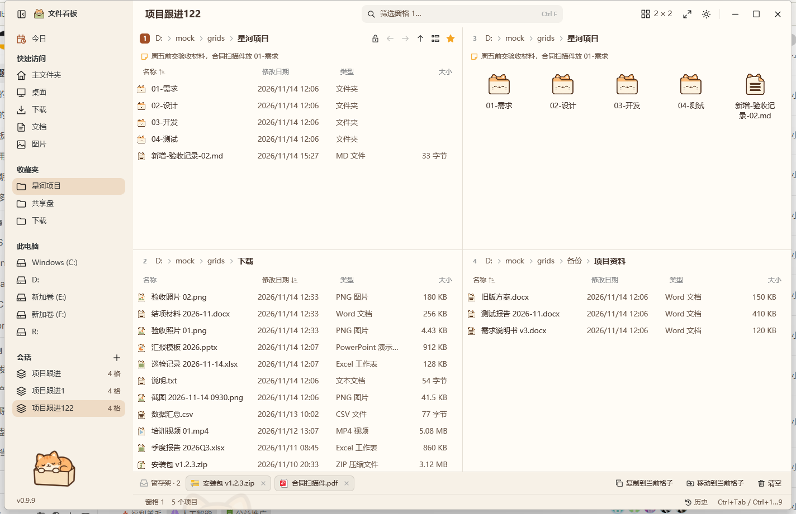
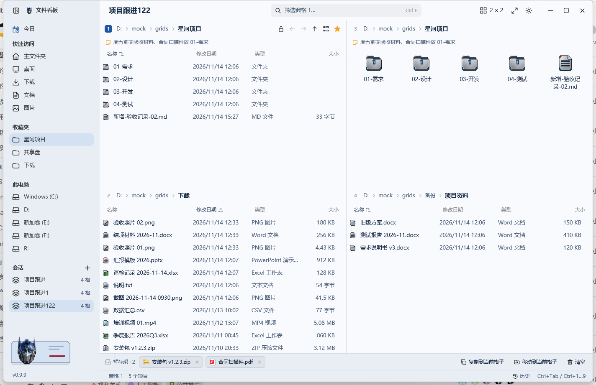

# 文件看板 PaneBoard

[English](README.en.md) | **简体中文**

Windows 多窗格文件管理器。一个窗口最多 16 个窗格，布局随手拖出来；变化实时高亮、目录可以彻底锁住、两个目录能并排核对，窗格之间还能先把文件攒起来再一起搬。

界面全部自绘（GPUI，Zed 用的 Rust UI 框架），不嵌入资源管理器视图。整个程序是一个 exe，主题也打包在里面，第一次运行自动展开。


本文截图使用演示用的模拟目录，不是真实桌面。

## 为什么做这个

日常在 Windows 上搬文件，痛点基本是这几条：

- 资源管理器一次只能看一个目录，复制一个文件要在两个窗口之间来回切，切多了就找不到自己在哪。
- 想知道「哪些文件最近被动过」，只能按修改时间排序，还得钻进每个目录逐个看。
- 给同事看资料、查历史归档时，担心手一滑就改名、删除或拖走，资源管理器没有「只看不改」。
- 备份完总要核对两个目录是不是一致，靠肉眼一行行比，费时还容易漏。
- 跨好几个目录挑文件，只能一个个复制粘贴，中间还要记住自己挑过哪些。

文件看板就是把这些动作收进一个窗口：多格并排、变化高亮、只读锁定、联动对比、暂存架，加上命令面板和撤销，尽量少用鼠标。

## 它能带来什么

- 少切窗口：四格常驻，左边源目录、右边目标目录，拖一下就完成。
- 不丢改动：哪一格有新文件，标题旁直接显示 `+1`、`+2`，不用逐格翻。
- 不怕误操作：查看归档时把窗格锁上，鼠标键盘都改不动，解锁只能用该窗格的锁按钮。
- 核对更快：两个窗格联动加对比，绿色和琥珀色直接把差异标出来。
- 找得到刚改的东西：今日视图按今天、3 天、7 天汇总所有窗格目录的变化。

## 功能

### 窗格与布局

- 1 到 16 个窗格：最多 4 列，每列 1 到 4 个。布局按钮提供 13 个预设；「按列自定义」里的竖条可以点，也可以按住横向拖动，一次改好几列。
- 拖动分隔线调整大小，双击分隔线让两格等分。
- 每个窗格各自记住目录、前进后退历史、排序、列宽和视图；交换两个窗格时这些一起搬过去。
- 侧栏包含今日、快速访问、收藏夹、磁盘盘符和已保存的会话。

### 文件操作

- 面包屑路径：点文件夹直接进入，点 `›` 列出子文件夹。
- 名称筛选（Ctrl+F）、五种视图（Ctrl+Shift+1 到 5）、可排序可调宽的列。
- 显示隐藏文件（Ctrl+H）、用星标收藏文件夹、标题下显示一行备注。
- 选择方式与资源管理器一致：单击、Ctrl+单击、Shift+单击、Ctrl+A，以及在空白处拖出选框。
- 右键菜单：打开、在下一格打开、剪切、复制、粘贴到文件夹、重命名、删除、压缩为 ZIP、备注、收藏、加入暂存架、在资源管理器中显示、查看占用、属性。

### 监视与变化高亮

每个窗格监视自己的目录，磁盘上有变化就重新读取。


- 新增或修改的文件高亮 4 秒：前 2 秒满强度，再用 2 秒淡出。
- 标题旁的计数（`+1`、`+2`……）持续累加，直到你碰这个窗格才清零。
- 你在别处时发生的改动同样计数，所以 16 格铺开时，一眼能看出哪几格动过。

### 只读锁定

用窗格标题栏的锁按钮锁定目录。锁上后整格覆盖一层遮罩：鼠标和键盘都不能选中、打开、拖出、拖入、改名或删除。


这层保护只在文件看板内生效，不是 NTFS 权限，其他程序仍可写入该目录。

### 联动与对比

两个窗格可以联动：一边进入子文件夹，另一边按各自的基准目录跟到相同位置，最多 4 组。

只联动两个窗格并打开对比，就能看出两边差异：绿色表示只在本侧有这个名字，琥珀色表示同名但大小或日期不同。


### 今日

按最近一天、3 天、7 天列出各窗格目录下发生变化的文件，最新的在前，并标出它来自哪个目录。


Enter 打开，Ctrl+Enter 在对应窗格里定位，Ctrl+C 复制，Ctrl+Shift+A 加入暂存架，Delete 移入回收站。被监视的目录有变化时会自动重新扫描。

### 暂存架

把文件拖进底部的暂存架，或用 Ctrl+Shift+A 把选中项放进去，再复制或移动到当前窗格。跨目录、跨窗格收集文件都可以。

### 会话

改动即时保存，下次打开还是原样。在侧栏给当前布局起名保存，会话列表会显示窗格数量，点一下恢复布局和每个窗格的目录。

### 命令面板与其他隐形功能

Ctrl+K 打开命令面板，可搜命令、已打开的目录和保存的会话。


Enter 执行命令或打开目录，Ctrl+Enter 在下一格打开该目录。下面这些不太显眼，但用过就回不去：

| 功能 | 用法 |
| --- | --- |
| 地址栏 | Ctrl+L 或 Alt+D，可输入路径、`..`、子文件夹名，或 `cmd` 这类命令 |
| 快速收集 | Ctrl+Shift+A 把选中项放进暂存架 |
| 撤销 | Ctrl+Z 撤销上一步，历史面板可查最近 500 条 |
| 最大化一格 | Ctrl+Shift+M，或双击窗格标题栏 |
| 只移动光标 | Ctrl+↑ / Ctrl+↓，不改选择 |
| 复制完整路径 | Ctrl+Shift+C |
| 交换窗格 | Ctrl+Alt+Shift+方向键 |
| 隐藏侧栏 | Ctrl+B |
| 调用资源管理器菜单 | Shift+F10 或菜单键 |

### 主题与外观

内置两套主题，随程序一起发布，第一次运行自动展开到 `themes\`：

- **奶油猫咪**：暖奶油配色，猫咪插画与图标。
- **变形金刚**：钢蓝配色，金属质感插画与图标。





主题不是只换颜色：配色、89 个工具栏图标、文件类型图标、空文件夹与搜索无结果插画、联动缺目录插画、版本弹层横幅、侧栏插画、窗口背景都会换。

浅色、深色、跟随系统三档独立于主题，每套主题都提供两套色板。切换在左下角版本号里选，选完自动重启生效。

主题可以自己画：一个文件夹加 `theme.json`、`icons/`、`types/` 和几张插画，放进 `themes\` 即可，格式见 [docs/theme-assets.md](docs/theme-assets.md)。欢迎把你的主题提上来。

## 快捷键

| 按键 | 动作 |
| --- | --- |
| Ctrl+Tab / Ctrl+Shift+Tab | 下一个 / 上一个窗格 |
| Ctrl+1 … Ctrl+9 | 跳到第 N 个窗格 |
| Ctrl+Alt+Shift+← / → / ↑ / ↓ | 与相邻窗格交换位置 |
| Ctrl+Shift+M | 最大化 / 还原当前窗格 |
| Ctrl+Shift+G | 布局选择 |
| Ctrl+B | 显示 / 隐藏侧栏 |
| Alt+← / Alt+→ / Alt+↑ | 后退 / 前进 / 上一级 |
| Ctrl+L、Alt+D | 地址栏 |
| Ctrl+F | 名称筛选 |
| Ctrl+H | 显示隐藏文件 |
| Ctrl+A | 全选 |
| Ctrl+C / Ctrl+X / Ctrl+V | 复制 / 剪切 / 粘贴 |
| Ctrl+Shift+C | 复制完整路径 |
| Ctrl+Shift+A | 选中项加入暂存架 |
| F2 / Delete / Shift+Delete | 重命名 / 移入回收站 / 永久删除 |
| F5 | 重新读取当前目录 |
| F7、Ctrl+Shift+N | 新建文件夹 |
| Alt+Enter | 属性 |
| Shift+F10、菜单键 | 右键菜单 |
| Ctrl+Shift+1 … 5 | 视图：超大图标、大图标、中图标、列表、详细信息 |
| Ctrl+K | 命令面板 |
| Ctrl+Z | 撤销上一步操作 |
| Ctrl+↑ / Ctrl+↓ | 只移动光标，不改选择 |

## 下载

在 [Releases](https://github.com/Joyi-code/grids/releases/latest) 下载 `grids-版本号.exe`，放到任意目录运行即可，只有一个文件。两套主题已经打包进 exe，第一次运行会在旁边生成 `themes\`，点左下角版本号就能选。

不需要安装，C 运行库已静态链接。程序未做代码签名，首次运行 Windows SmartScreen 可能提示：点「更多信息」→「仍要运行」。

Windows 10（1903 及以上）或 Windows 11，x64。

## 更新

启动时查一次 GitHub 最新版本，有新版时左下角出现「更新到 x.y.z」。点一下就会下载、校验 SHA-256、替换 exe 并重启，下载过程中显示百分比。

更新只替换 exe 本身：配置 `grids-gpui.json`、操作日志 `grids-journal.jsonl`、`themes\` 都不会被删除或改写；下载失败或哈希不一致时不替换任何文件。

## 隐私

唯一的网络请求是版本检查：一次 GET，地址是 `api.github.com/repos/Joyi-code/grids/releases/latest`，不带参数和标识，由系统 `curl.exe` 发出，程序本身不链接网络库。版本弹层里的开关可以关掉，关掉后程序完全不联网。没有遥测，不上传文件名或目录内容。

## 限制

- 只读锁定只在文件看板内生效。
- 对比看名称、大小和日期，目录只看是否存在，不递归比较。
- 今日视图扫描每个窗格目录下三层，最多 20,000 个文件。
- 撤销只覆盖文件看板记录的操作，其他程序里的改动不会被记录。
- 文件夹图标来自主题包；主题缺 `types\` 时会退回 Windows 系统图标。

## 参与

- 有新主题、新功能的想法，或者发现 bug，欢迎提 [Issue](https://github.com/Joyi-code/grids/issues)。
- 想直接改代码或做主题，欢迎 PR；提交前跑 `cargo test --release --locked --workspace`。
- 接下来会继续加主题（工艺、像素、极简等不同审美），以及拖拽增强、批量重命名、更多文件操作。有想要的先说一声。

## 从源码构建

需要 [rustup](https://rustup.rs) 安装的 Rust 工具链（版本固定在 `rust-toolchain.toml`）和 Windows SDK；GPUI 用 SDK 的 `fxc.exe` 编译着色器。

```
build.cmd
```

或直接 `cargo build --release --locked`。产物是单个 `grids.exe`；配置（`grids-gpui.json`）和操作日志（`grids-journal.jsonl`）写在 exe 同目录，所以该目录必须可写。`GRIDS_CONFIG=<路径>` 可改配置位置，`GRIDS_LANG=en` 以英文启动，`GRIDS_LOG=info` 把日志输出到 stderr。

## 联系我

微信：`pixel-cafetime`（像素与咖啡时光）


用之前最好先说明来意。项目相关的问题也可以直接在这里提 Issue。

## 致谢

文件看板是 [efww/grids](https://github.com/efww/grids)（MIT）的 fork，上游曾受 [Q-Dir](https://www.softwareok.com/?seite=Freeware/Q-Dir) 启发。本次重写基于 [GPUI](https://www.gpui.rs)。第三方声明见 [THIRD_PARTY.md](THIRD_PARTY.md)。

## 许可

[MIT](LICENSE)

