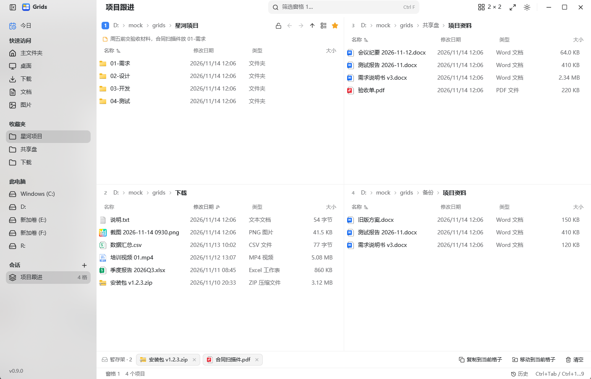
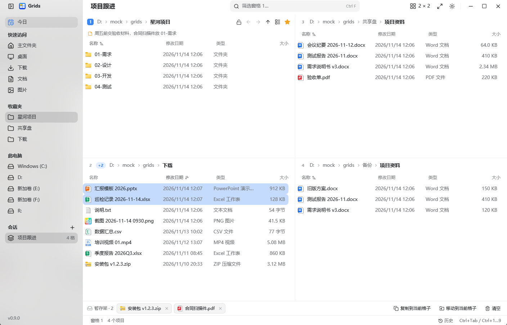
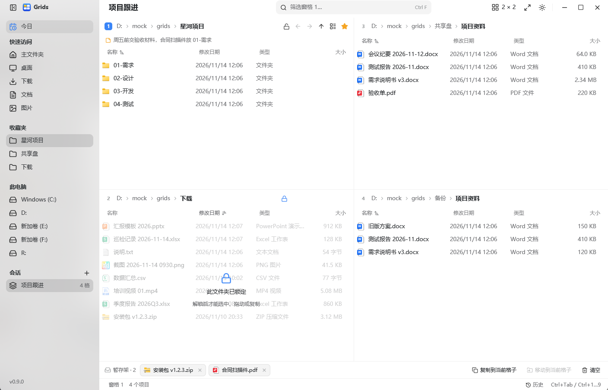
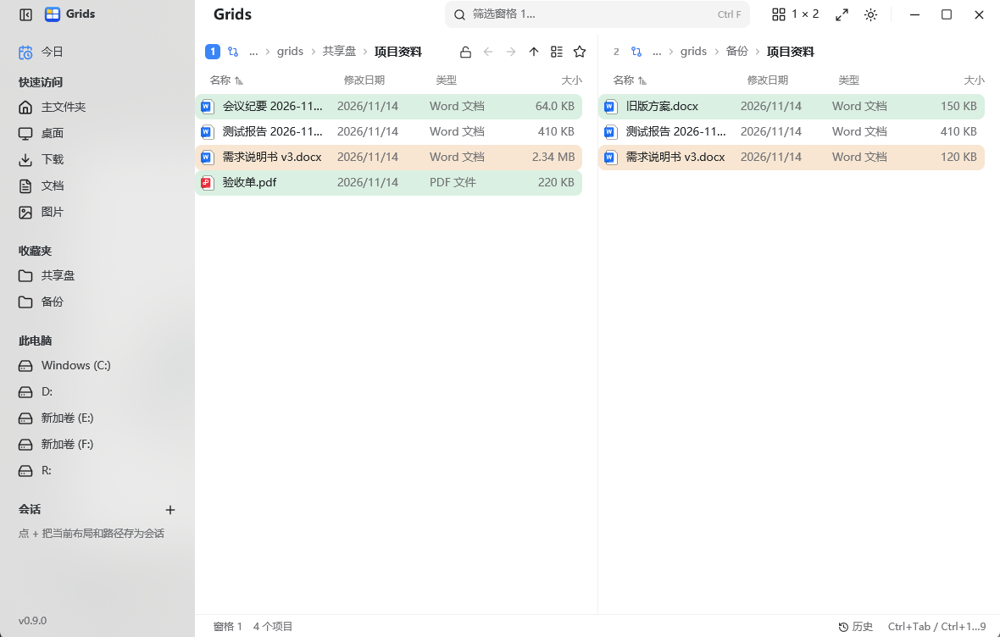
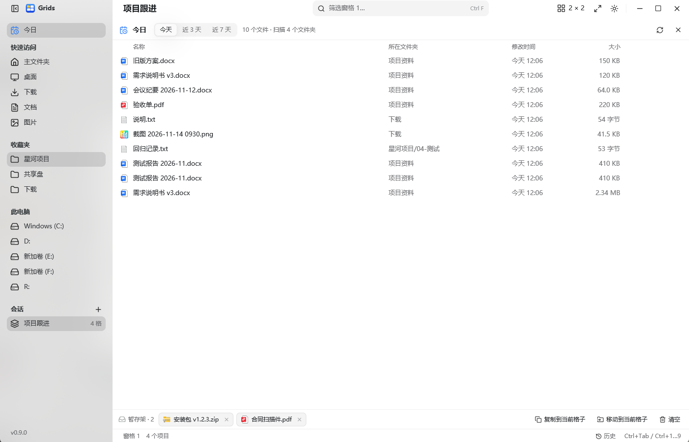
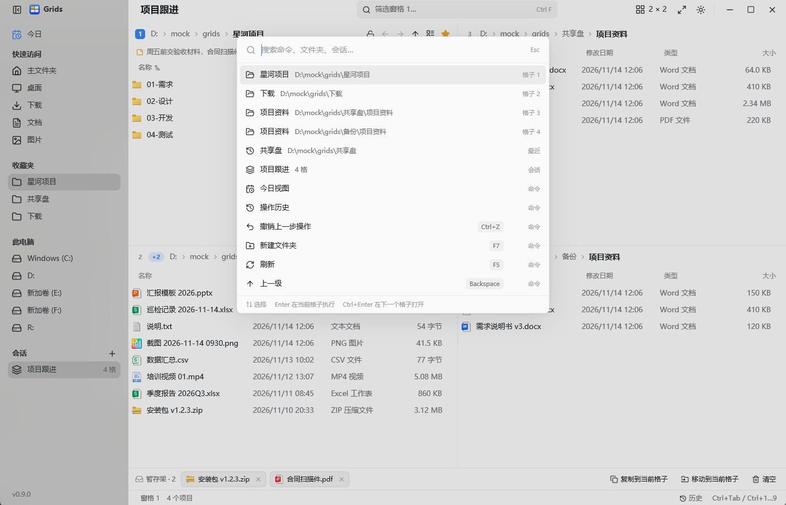
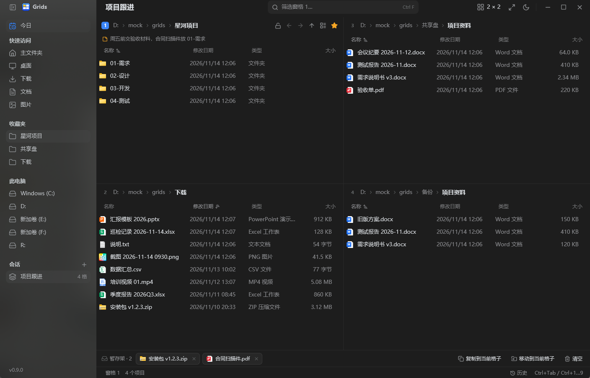

# Grids

A multi-pane file manager for Windows, drawn entirely by the app: up to 16 panes in one window, layouts you shape by dragging, and a few things Explorer does not do. A Today view, live change highlights, read-only folders that cannot be dragged out, linked panes that compare two folder trees, and a shelf for carrying files between panes.

This repository is a fork and a rewrite. Grids began as [efww/grids](https://github.com/efww/grids), a Q-Dir style manager whose panes were embedded Windows Explorer views. Here the window, the file lists and every menu and dialog are drawn by the app itself with [GPUI](https://www.gpui.rs), the Rust UI framework behind Zed. No Explorer view is embedded anywhere, and the program is a single exe of about 5.5 MB that never touches the network.



The screenshots in this README show a mock project tree, not a real desktop.

[한국어](README.ko.md)

## Panes and layouts

- 1 to 16 panes: up to 4 columns, each with 1 to 4 panes. The layout button offers 13 presets, and the bars under **By column** set how many panes each column holds; press and drag across them to change several columns at once.
- Drag any divider to resize, double-click it to even the panes out.
- Maximize the active pane with Ctrl+Shift+M or a double-click on its header.
- Each pane keeps its own folder, history, sort, column widths and view; swapping two panes takes all of it along (Ctrl+Alt+Shift+arrows).
- The sidebar holds Today, quick access, favourites, the drives, and saved sessions.

## Inside a pane

- Breadcrumb path: click a folder to go there, click `›` for the folders inside, or press Ctrl+L / Alt+D and type a path, `..`, a subfolder name, or a command such as `cmd`.
- Back, forward, up, a name filter (Ctrl+F), five view modes (Ctrl+Shift+1 to 5), sortable and resizable columns.
- Hidden files (Ctrl+H), a star that files the folder under favourites, and a note line under the title.
- Selection as in Explorer: click, Ctrl+click, Shift+click, Ctrl+A, and a rubber-band box dragged from empty space.
- The context menu opens files and folders, opens a folder in the next pane, cuts, copies, pastes into a folder, renames, deletes, makes a ZIP, adds a note or a favourite, adds to the shelf, shows the item in Explorer, asks which program is using it, and shows properties.

## Sessions

Settings are written as you change them, so the app reopens where you left it. Save a named session from the sidebar and it appears in the Sessions list with its pane count; one click brings the layout and every pane's folder back.

## Watching folders

Each pane watches its own folder and reloads when something changes on disk.



- A new or modified file gets an accent wash for four seconds: full strength for two, then fading away.
- A counter next to the pane title adds the changes up (`+1`, `+2`, …) and stays until you touch the pane: click it, use the keys, press F5, or open another folder.
- The pane that changed while you were elsewhere keeps its own total, so a wall of 16 panes shows at a glance which ones moved.

## Read-only folders

Lock a folder from the button in the pane header. The pane is then covered by a veil: nothing can be selected, opened, dragged out, dropped in, renamed or deleted, by mouse or keyboard. Only the pane's own lock button unlocks it again.



This is protection inside Grids, not an NTFS permission: other programs can still write to the folder.

## Linked panes and compare

Two panes can be linked, so entering a subfolder in one takes the other to the same place relative to its own base folder (up to 4 groups).

Link exactly two panes and turn compare on to see the differences between the two folders: green for a name that exists only on this side, amber for the same name with another size or date.



## The shelf

Drag files onto the shelf, or add the selection with Ctrl+Shift+A, then copy or move them into whichever pane is active. The shelf carries them across folders and panes.

## Today

Shows what changed below the panes' folders in the last day, 3 days or 7 days, newest first, with the folder each file came from.



Enter opens a file, Ctrl+Enter shows it in its pane, Ctrl+C copies, Ctrl+Shift+A puts it on the shelf, Delete sends it to the Recycle Bin. The view rescans itself when a watched folder changes.

## History and undo

Every file operation Grids performs is recorded in `grids-journal.jsonl`. Ctrl+Z undoes the newest one, and the History panel lists the last 500 operations with what they touched and when.

## Command palette

Ctrl+K opens a palette of commands, open folders and saved sessions.



Enter runs a command or opens a folder, Ctrl+Enter opens a folder in the next pane.

## Look and language

- Light, dark, or follow Windows.
- Simplified Chinese by default; `GRIDS_LANG=en` starts in English.



## Keyboard

| Keys | Action |
| --- | --- |
| Ctrl+Tab / Ctrl+Shift+Tab | Next / previous pane |
| Ctrl+1 … Ctrl+9 | Go to that pane |
| Ctrl+Alt+Shift+← / → / ↑ / ↓ | Swap the active pane with its neighbour |
| Ctrl+Shift+M | Maximize / restore the active pane |
| Ctrl+Shift+G | Layout picker |
| Ctrl+B | Show / hide the sidebar |
| Alt+← / Alt+→ / Alt+↑ | Back / forward / up |
| Ctrl+L, Alt+D | Address bar (a path, `..`, or a command) |
| Ctrl+F | Name filter |
| Ctrl+H | Show hidden files |
| Ctrl+A | Select all |
| Ctrl+C / Ctrl+X / Ctrl+V | Copy / cut / paste |
| Ctrl+Shift+C | Copy the full path |
| Ctrl+Shift+A | Add the selection to the shelf |
| F2 / Delete / Shift+Delete | Rename / Recycle Bin / delete for good |
| F5 | Reload the folder |
| F7, Ctrl+Shift+N | New folder |
| Alt+Enter | Properties |
| Shift+F10, Menu key | Context menu |
| Ctrl+Shift+1 … 5 | View modes: huge, large, medium, list, details |
| Ctrl+K | Command palette |
| Ctrl+Z | Undo the last operation |
| Ctrl+↑ / Ctrl+↓ | Move the cursor without changing the selection |

## Running it

Build it with the Rust toolchain from [rustup](https://rustup.rs) (the version is pinned in `rust-toolchain.toml`) and the Windows SDK; GPUI compiles its shaders with the SDK's `fxc.exe`.

```
build.cmd
```

or

```
cargo build --release --locked
```

`build.cmd` also points `GPUI_FXC_PATH` at the newest installed SDK, as CI does. Tests: `cargo test --release --locked --workspace`.

The result is a single `grids.exe`; put it in any folder and run it. There is no prebuilt download for this version yet, so build it as above. Settings (`grids-gpui.json`) and the operation journal (`grids-journal.jsonl`) are written next to the exe, so the folder has to be writable. `GRIDS_CONFIG=<path>` puts the settings somewhere else, and `GRIDS_LOG=info` logs warnings to stderr.

Windows 10 (1903 or later) or Windows 11, x64. The C runtime is linked statically, so a clean Windows starts it without the Visual C++ Redistributable.

## Limits

- Read-only folders are enforced inside Grids only.
- Compare looks at names, sizes and dates, and at folders by existence; it does not recurse.
- Today scans three levels below each pane's folder, up to 20,000 files.
- Undo covers the operations Grids recorded; changes made in other programs are not recorded.
- The app has no network code at all: no updates check, no telemetry.

## Credits

Grids is a fork of [efww/grids](https://github.com/efww/grids) (MIT), which was inspired by [Q-Dir](https://www.softwareok.com/?seite=Freeware/Q-Dir). The rewrite is built on [GPUI](https://www.gpui.rs). Third-party notices are in [THIRD_PARTY.md](THIRD_PARTY.md).

## License

[MIT](LICENSE)
