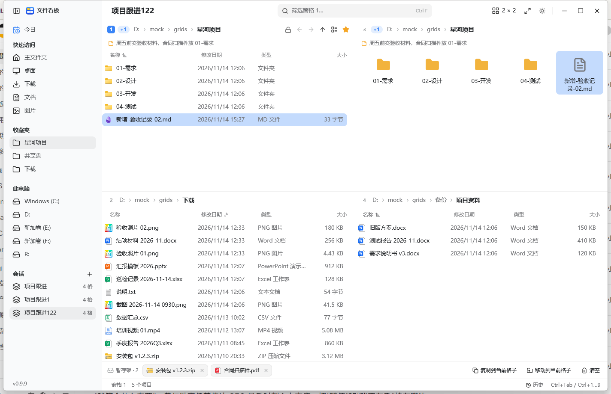
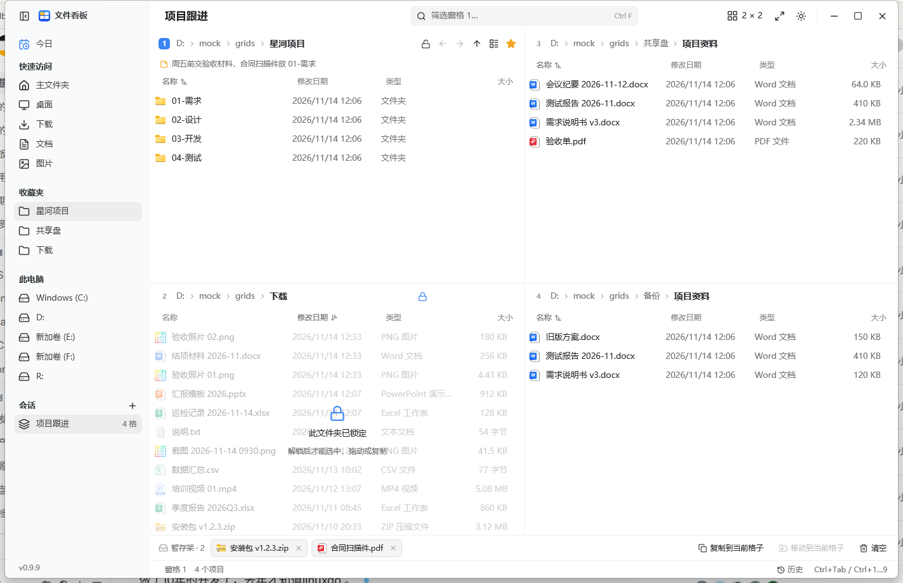
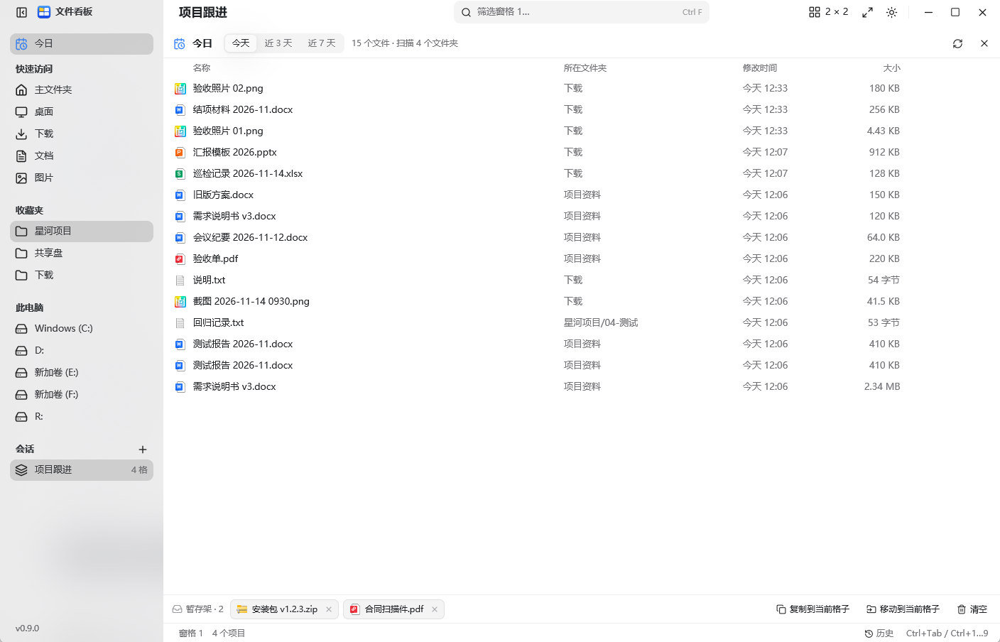
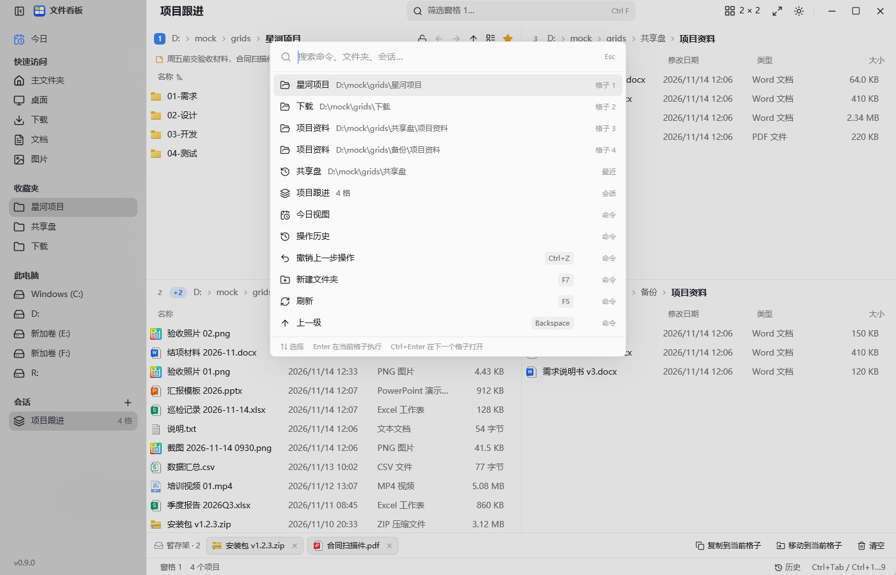
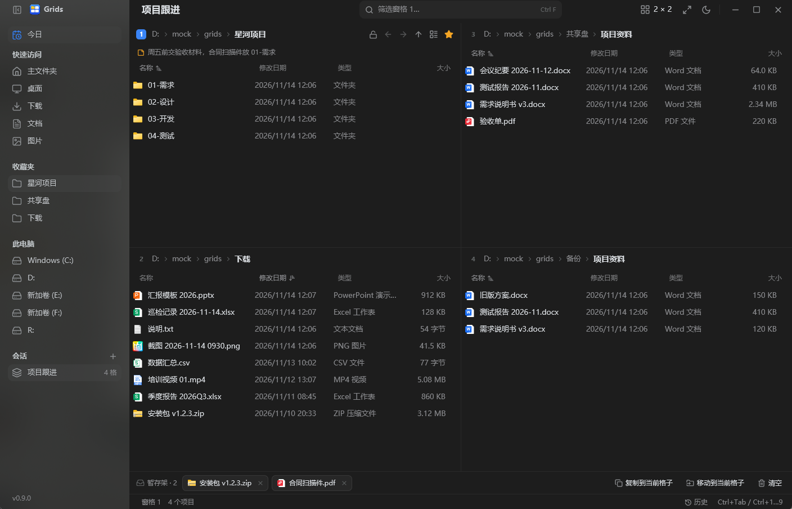

# Grids

[English](README.md) | **简体中文**

Windows 多窗格文件管理器，界面全部由程序自己绘制：一个窗口最多 16 个窗格，布局随手拖出来，还有资源管理器没有的几样东西。今日视图、变化实时高亮、拖不走的只读文件夹、能对比两个目录的联动窗格，以及在窗格之间搬运文件的暂存架。

本仓库是 fork 之后的重写。Grids 起源于 [efww/grids](https://github.com/efww/grids)，那是一个把资源管理器视图嵌进窗格的 Q-Dir 风格管理器。这里的窗口、文件列表、菜单与对话框全部用 [GPUI](https://www.gpui.rs)（Zed 的 Rust UI 框架）自绘，不嵌入任何资源管理器视图；整个程序是一个约 5.5 MB 的 exe，不会上传任何东西，唯一的网络请求是下面说的版本检查。

界面里的名字是 **文件看板**（中文）和 **PaneBoard**（英文）。仓库名、可执行文件 `grids.exe` 和配置文件名仍沿用 Grids。


本文截图使用演示用的模拟目录，不是真实桌面。

## 窗格与布局

- 1 到 16 个窗格：最多 4 列，每列 1 到 4 个。布局按钮提供 13 个预设；「按列自定义」里的竖条可以点，也可以按住横向拖动，一次改好几列。
- 拖动分隔线调整大小，双击分隔线让两格等分。
- Ctrl+Shift+M 或双击窗格标题栏，最大化当前窗格。
- 每个窗格各自记住目录、前进后退历史、排序、列宽和视图；交换两个窗格时这些一起搬过去（Ctrl+Alt+Shift+方向键）。
- 侧栏包含今日、快速访问、收藏夹、磁盘盘符和已保存的会话。

## 窗格内

- 面包屑路径：点文件夹直接进入，点 `›` 列出子文件夹，Ctrl+L 或 Alt+D 输入路径、`..`、子文件夹名，或 `cmd` 这类命令。
- 后退、前进、上一级、名称筛选（Ctrl+F）、五种视图（Ctrl+Shift+1 到 5）、可排序可调宽的列。
- 显示隐藏文件（Ctrl+H）、用星标把文件夹收进收藏夹、标题下显示一行备注。
- 选择和资源管理器一致：单击、Ctrl+单击、Shift+单击、Ctrl+A，以及在空白处拖出选框。
- 右键菜单：打开、在下一格打开、剪切、复制、粘贴到文件夹、重命名、删除、压缩为 ZIP、备注、收藏、加入暂存架、在资源管理器中显示、查看占用、属性。

## 会话

改动即时保存，下次打开还是原样。在侧栏给当前布局起名保存，会话列表会显示窗格数量；点一下就能恢复布局和每个窗格的目录。

## 监视文件夹

每个窗格都监视自己的目录，磁盘上有变化就重新读取。



- 新增或修改的文件高亮 4 秒：前 2 秒满强度，再用 2 秒淡出。
- 标题旁的计数（`+1`、`+2`……）持续累加，直到你碰这个窗格才清零：点一下、按键、按 F5、或者进入别的目录。
- 你在别处时发生的改动同样计数，所以 16 格铺开时，一眼能看出哪几格动过。

## 只读文件夹

用窗格标题栏的锁按钮锁定目录。锁上后整格覆盖一层遮罩：鼠标和键盘都不能选中、打开、拖出、拖入、改名或删除。只有该窗格自己的锁按钮能解开。



这层保护只在 Grids 内生效，不是 NTFS 权限，其他程序仍可写入该目录。

## 联动与对比

两个窗格可以联动：一边进入子文件夹，另一边按各自的基准目录跟到相同位置，最多 4 组。

只联动两个窗格并打开对比，就能看出两边差异：绿色表示只在本侧有这个名字，琥珀色表示同名但大小或日期不同。


## 暂存架

把文件拖进暂存架，或用 Ctrl+Shift+A 把选中项放进去，再复制或移动到当前窗格。跨目录、跨窗格收集文件都可以。

## 今日

按最近一天、3 天、7 天列出各窗格目录下发生变化的文件，最新的在前，并标出它来自哪个目录。



Enter 打开，Ctrl+Enter 在对应窗格里定位，Ctrl+C 复制，Ctrl+Shift+A 加入暂存架，Delete 移入回收站。被监视的目录有变化时会自动重新扫描。

## 历史与撤销

Grids 执行的每个文件操作都记录在 `grids-journal.jsonl`。Ctrl+Z 撤销最近一次，历史面板列出最近 500 条，含对象和时间。

## 命令面板

Ctrl+K 打开命令面板，可搜命令、已打开的目录和保存的会话。



Enter 执行命令或打开目录，Ctrl+Enter 在下一格打开该目录。

## 外观与语言

- 浅色、深色，或跟随系统。
- 默认简体中文；`GRIDS_LANG=en` 启动即为英文。



## 快捷键

| 按键 | 动作 |
| --- | --- |
| Ctrl+Tab / Ctrl+Shift+Tab | 下一个 / 上一个窗格 |
| Ctrl+1 … Ctrl+9 | 跳到第 N 个窗格 |
| Ctrl+Alt+Shift+← / → / ↑ / ↓ | 与相邻窗格交换位置 |
| Ctrl+Shift+M | 最大化 / 还原当前窗格 |
| Ctrl+Shift+G | 布局选择 |
| Ctrl+B | 显示 / 隐藏侧栏 |
| Alt+← / Alt+→ / Alt+↑ | 后退 / 前进 / 上一级 |
| Ctrl+L、Alt+D | 地址栏（路径、`..` 或命令） |
| Ctrl+F | 名称筛选 |
| Ctrl+H | 显示隐藏文件 |
| Ctrl+A | 全选 |
| Ctrl+C / Ctrl+X / Ctrl+V | 复制 / 剪切 / 粘贴 |
| Ctrl+Shift+C | 复制完整路径 |
| Ctrl+Shift+A | 选中项加入暂存架 |
| F2 / Delete / Shift+Delete | 重命名 / 移入回收站 / 永久删除 |
| F5 | 重新读取当前目录 |
| F7、Ctrl+Shift+N | 新建文件夹 |
| Alt+Enter | 属性 |
| Shift+F10、菜单键 | 右键菜单 |
| Ctrl+Shift+1 … 5 | 视图：超大图标、大图标、中图标、列表、详细信息 |
| Ctrl+K | 命令面板 |
| Ctrl+Z | 撤销上一步操作 |
| Ctrl+↑ / Ctrl+↓ | 只移动光标，不改选择 |

## 下载

在 [Releases](https://github.com/Joyi-code/grids/releases/latest) 下载 `grids.exe`，放到任意目录运行即可，不需要安装，C 运行库已静态链接。

程序未做代码签名，首次运行 Windows SmartScreen 可能提示：点「更多信息」→「仍要运行」。

Windows 10（1903 及以上）或 Windows 11，x64。

## 运行

需要 [rustup](https://rustup.rs) 安装的 Rust 工具链（版本固定在 `rust-toolchain.toml`）和 Windows SDK；GPUI 用 SDK 的 `fxc.exe` 编译着色器。

```
build.cmd
```

或直接：

```
cargo build --release --locked
```

`build.cmd` 会像 CI 一样把 `GPUI_FXC_PATH` 指向最新安装的 SDK。测试：`cargo test --release --locked --workspace`。

产物是单个 `grids.exe`，放到任意目录即可运行。配置（`grids-gpui.json`）和操作日志（`grids-journal.jsonl`）写在 exe 同目录，所以该目录必须可写。`GRIDS_CONFIG=<路径>` 可改配置位置，`GRIDS_LOG=info` 把警告输出到 stderr。

## 版本更新

Grids 在启动时向 GitHub 查询一次最新版本号。有更新时，侧栏左下角会出现「新版本」按钮，点一下打开发布页下载新的 exe。

这个检查不上传任何个人信息或文件内容：只有一次 GET 请求，地址是 `api.github.com/repos/Joyi-code/grids/releases/latest`，不带参数、不带标识；请求由系统的 `curl.exe` 发出，程序本身不链接任何网络库。版本弹层里的「启动时检查」可以关掉，关掉后程序完全不联网。代码开源，这一段可以直接查。

## 限制

- 只读文件夹只在 Grids 内生效。
- 对比看名称、大小和日期，目录只看是否存在，不递归比较。
- 今日视图扫描每个窗格目录下三层，最多 20,000 个文件。
- 撤销只覆盖 Grids 记录的操作，其他程序里的改动不会被记录。
- 唯一的网络请求是版本检查，可以关闭，没有遥测，也不会上传文件。

## 致谢

Grids 是 [efww/grids](https://github.com/efww/grids)（MIT）的 fork，上游曾受 [Q-Dir](https://www.softwareok.com/?seite=Freeware/Q-Dir) 启发。本次重写基于 [GPUI](https://www.gpui.rs)。第三方声明见 [THIRD_PARTY.md](THIRD_PARTY.md)。

## 许可

[MIT](LICENSE)
